

  

<h1 align="center">Smart Sleep Timer</h1>

  <b>Set the time. Let the computer handle the rest.</b> 
  A Windows timer that can sleep, lock or shut down your PC, and that learns when the PC has gone quiet.

  English · <a href="README.tr.md">Türkçe</a>

  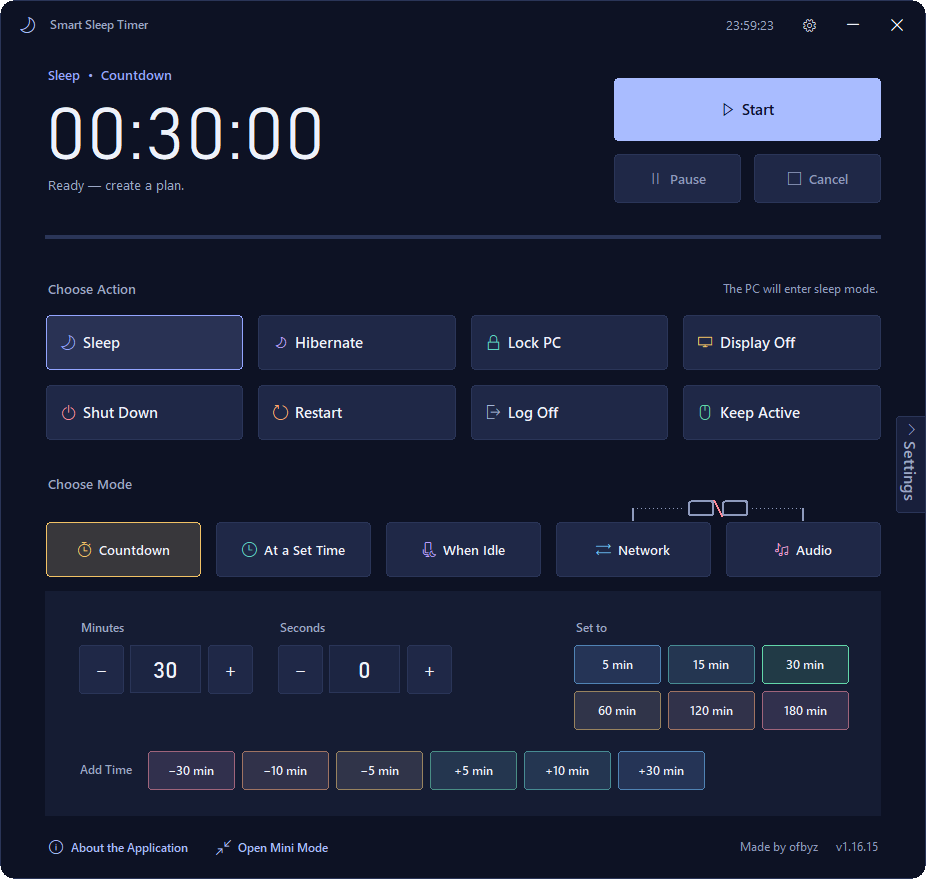
  &nbsp;
  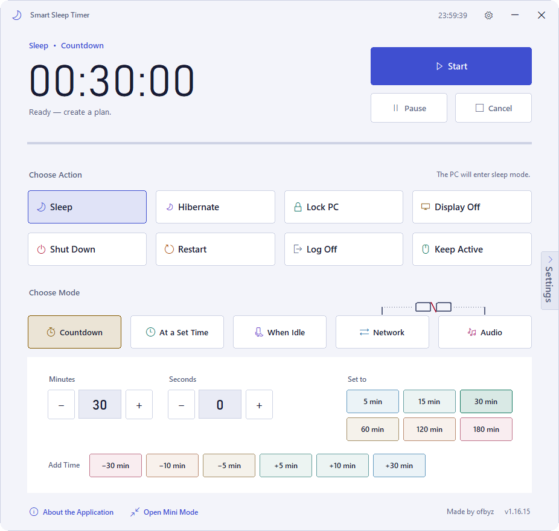

---

## What it is

You fall asleep during a film, a big download finishes, and nobody is there to turn the computer off. A fixed countdown cannot know when the work will end: it either cuts in too early or switches off too late.

Smart Sleep Timer does the usual timer jobs, and it can also look at what the computer is actually doing. When network and audio activity go quiet, it asks “Are you still there?” and only then acts.

- **Platform:** Windows. Tested by the author on Windows 10; I cannot confirm other versions.
- **Version:** 1.16.15
- **Interface:** dark and light themes, 10 languages (Türkçe, English, Nederlands, Deutsch, Español, Português, Russian, Arabic, Hindi, Simplified Chinese).

## How it works: three steps

1. **What should happen?** Sleep, Hibernate, Lock PC, Display Off, Shut Down, Restart, Log Off. Or Keep Active.
2. **When should it happen?** After a countdown, at a set time, when the computer is idle, or once network and audio go quiet.
3. **Press Start.** You are warned before the action and can cancel at any moment.

## Actions and modes

| Actions | Modes |
|---|---|
| Sleep · Hibernate · Lock PC · Display Off | **Countdown**: minutes and seconds, or quick buttons |
| Shut Down · Restart · Log Off | **At a Set Time**: a time of day, 24-hour format |
| **Keep Active** (a session, not an end action) | **When Idle**: mouse and keyboard unused for the time you choose |
| | **Network**: runs when traffic drops below the quiet limit (KB/s) |
| | **Audio**: runs when the sound level stays at or below the quiet limit (%) |

Network and Audio can be chained. One shared duration then runs once both are quiet.

  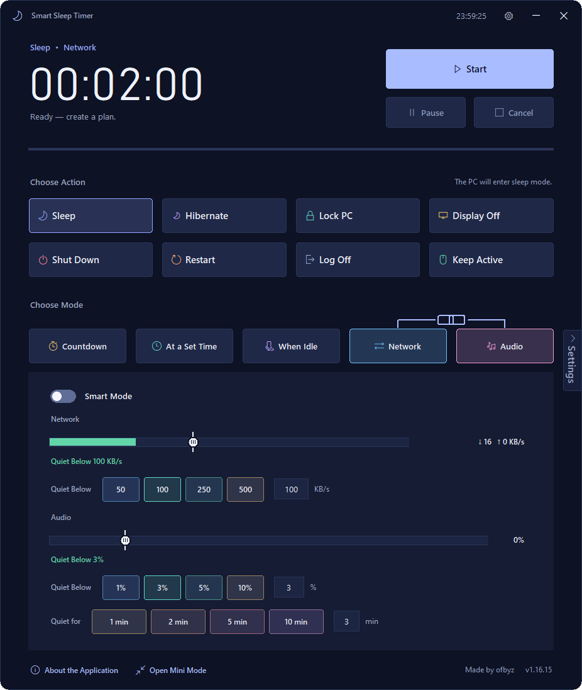

## Smart mode

Smart mode is available for Network and Audio. It chooses the quiet limit and the waiting time itself and improves as it learns.

**It asks first, warns next, acts last:**

1. **Quiet is detected.** Network or audio stays below the learned limit, and the mouse and keyboard have been unused for 60 seconds.
2. **“Are you still there?”** A silent window asks. Depending on how much the app trusts its data, it stays open 20 to 120 seconds.
3. **Final warning.** A separate window counts down, with a sound alert if enabled. At least 10 seconds.
4. **The action runs** if nobody answers. Smart mode asks for no extra confirmation, and it never force-closes open applications.

Each “I am here” adds 30 seconds to the wait for that session. Every answer, yes or no, is learning data.

### How boldly should it act?

The Smart settings page has a **Careful / Balanced / Bold** choice. Question length in seconds, by how much the app trusts what it learned:

| | Very low | Low | Medium | High | Very high |
|---|---|---|---|---|---|
| Careful | 120 | 100 | 80 | 60 | 45 |
| Balanced | 90 | 75 | 60 | 45 | 30 |
| Bold | 60 | 50 | 40 | 30 | 20 |

The choice also changes how much doubtful sensor data counts in learning (×0.5 · ×1 · ×1.6) and how long a quiet period is expected before acting (×1.5 · ×0.75 · ×0.6).

  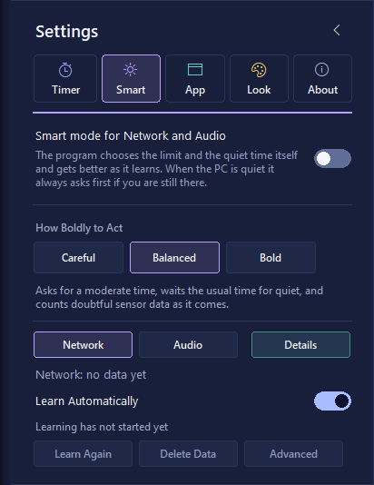
  &nbsp;
  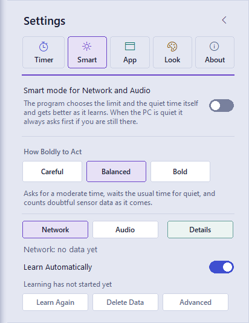

### Learning

- Learns your computer's “quiet” hour by hour over a 7-day window (14 days in the advanced setting).
- Needs 240 healthy samples per hour (one every 15 seconds), collected over at least 3 different days.
- If your habits change, the last 3 days are compared with the older data; for the hours that changed, older samples count with a weight of 0.3.
- After learning is complete it samples once a minute, for the lowest processor load.

### Telling noise from use

- **Network:** small, repeating background activity is learned and ignored. Traffic that lasts longer than 90 seconds, or does not match known patterns, counts as use. The decision uses a trimmed mean of the last 30 seconds (the highest 7% of readings are left out).
- **Audio:** measured per application. One-off sounds shorter than 4 seconds count as notifications. Samples from the app that is making sound right now are weighted 1.5×.
- **Mouse and keyboard:** the jitter threshold is learned from your computer, so a mouse shaking on a blanket is not “use”. There are no input hooks: only the time since the last input is read.

## Keep Active

A session that runs for the whole duration: the mouse makes small, natural movements and the computer counts as in use.

- 10-second lead-in, then a rhythm of 15 s, 30 s, 1 min, 2 min or Random (5–60 s).
- Movements of 30 to 420 pixels on a gentle curve, away from screen edges, never heading the same way twice in a row.
- It waits the moment you touch the mouse or keyboard. **Ctrl+Shift+X** stops it instantly.
- Schedule it as a countdown, at a set time, or When Idle (starts when the computer goes unused, ends when someone returns, 12 hours at most).

> Windows marks this kind of input as generated, and whether a particular monitoring program accepts it can only be found out by trying. Treat it as a user-controlled helper, not a guarantee.

  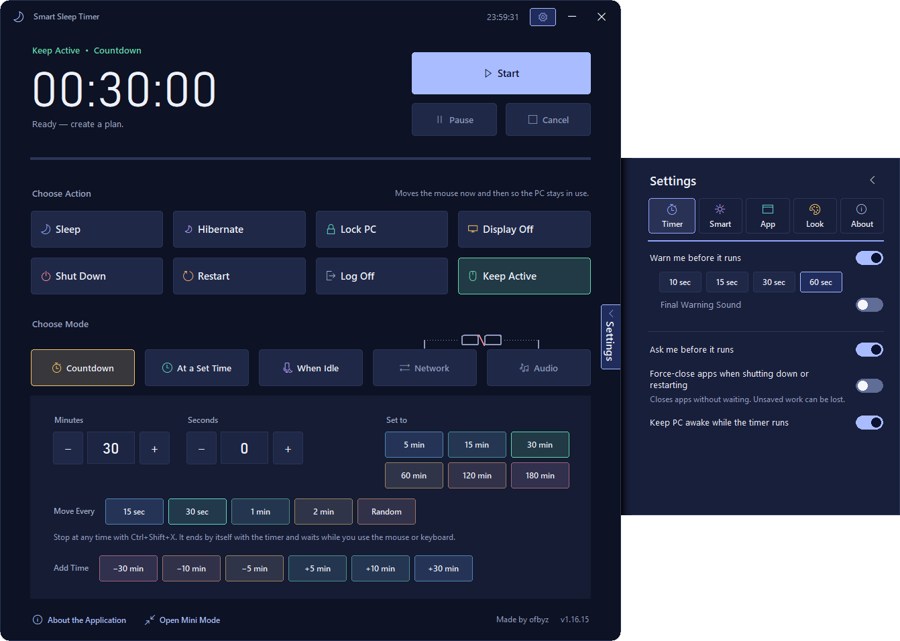

## Safety

- **Final warning:** 10, 15, 30 or 60 seconds, with +5 min, +10 min or Stop Timer.
- **Final confirmation:** can ask Continue / Cancel. If nobody answers for 10 minutes and the computer is hardly used, the action goes ahead on its own.
- **A timer does not survive sleep.** If the system goes to sleep, the timer is cancelled and the main window opens.

  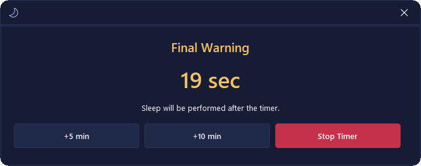
  &nbsp;
  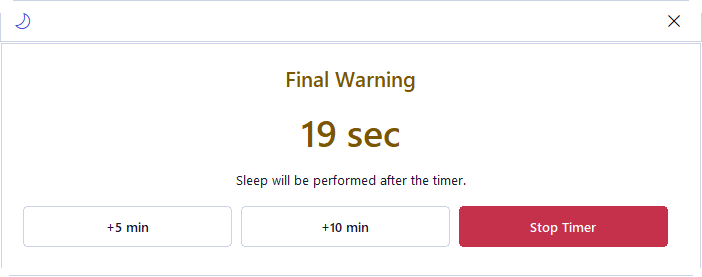

## Mini mode, themes and languages

One click in the tray opens Mini mode. It has the same action and mode choices, and Smart mode is managed there too. Theme (Dark, Light or System) and language are on the Settings → Look page. The settings drawer slides out from the right edge and has the pages Timer, Smart, App, Look and About.

  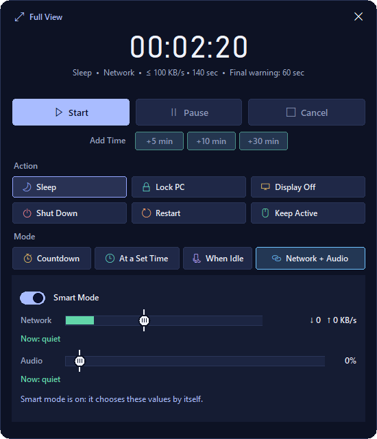
  &nbsp;
  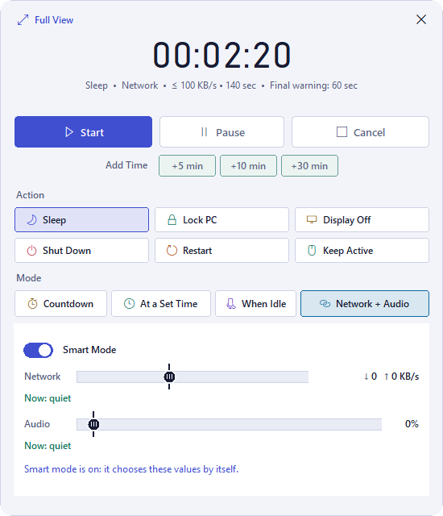
  &nbsp;
  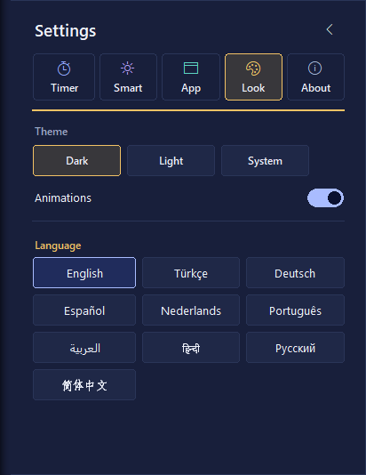

## Privacy

**Learned and stored:** the amount of network activity (KB/s), the audio output level, the name of the program making sound, and the hour of the day these happened.

**Never stored or inspected:** websites and addresses, files and application content, message content and media titles, audio recordings, keystrokes.

Data stays on your computer, in Windows' ProgramData folder (`%PROGRAMDATA%\Smart Sleep Timer`). Network and Audio data are separate files. When you uninstall, keeping or deleting the data is your choice.

## Download and install

Installers are published on the **Releases** page of this repository. The installer is available in 10 languages.

> The installer is not code-signed yet (planned for v2.1.0), so Windows may show a warning when you run it.

## Roadmap

Source: the project's own `ROADMAP.md`. No dates are promised.

- **Next:** accent color choice (ten colors and “Follow Windows”), each color tested for contrast in both themes.
- **v2.0.0:** Custom Profiles, a visual algorithm editor with AND, OR, NOT, XOR, IF and FOR, with templates and import/export. Switched off until then.
- **v2.1.0:** distribution: code signing, an update release channel, removal of the installer's privilege warning.
- **Ongoing:** fine-tuning Smart mode with decision records collected from real computers.

## Under the hood

About 15,800 lines of Python (the sum of the rounded per-layer counts in the project's `ARCHITECTURE.md`), 631 automated tests (last full run: v1.16.12), and a text-contrast check of at least 4.5:1 for every color pair. Windows calls sit behind one platform layer, and colors, fonts and icons live in one theme file.

## Support the project

If you would like to support the project with a donation, please contact me on Instagram: [@ofbyz](https://www.instagram.com/ofbyz)
