

  

<h1 align="center">Smart Sleep Timer</h1>

  <b>Zamanı belirleyin. Bilgisayar gerisini halletsin.</b> 
  Bilgisayarı uyutan, kilitleyen ya da kapatan; bilgisayarın ne zaman sessizleştiğini öğrenen bir Windows zamanlayıcısı.

  <a href="README.md">English</a> · Türkçe

  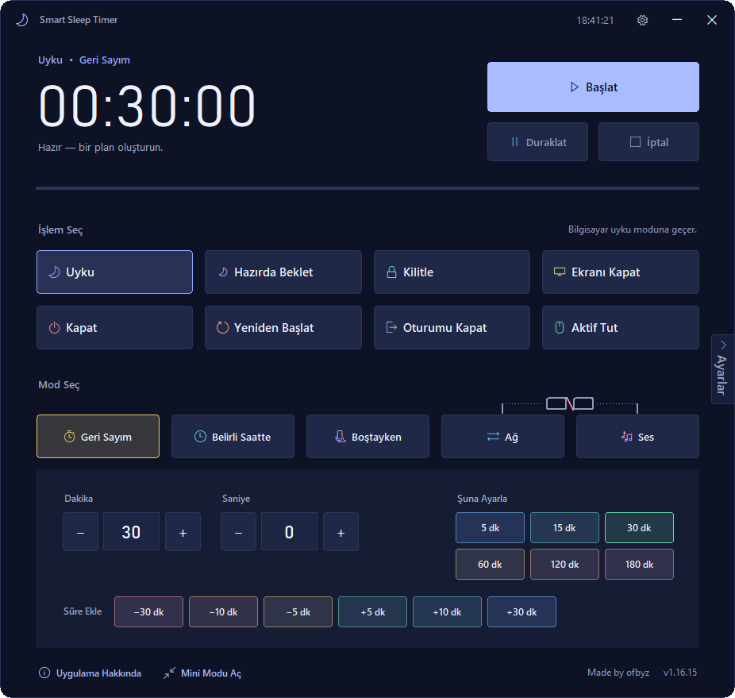
  &nbsp;
  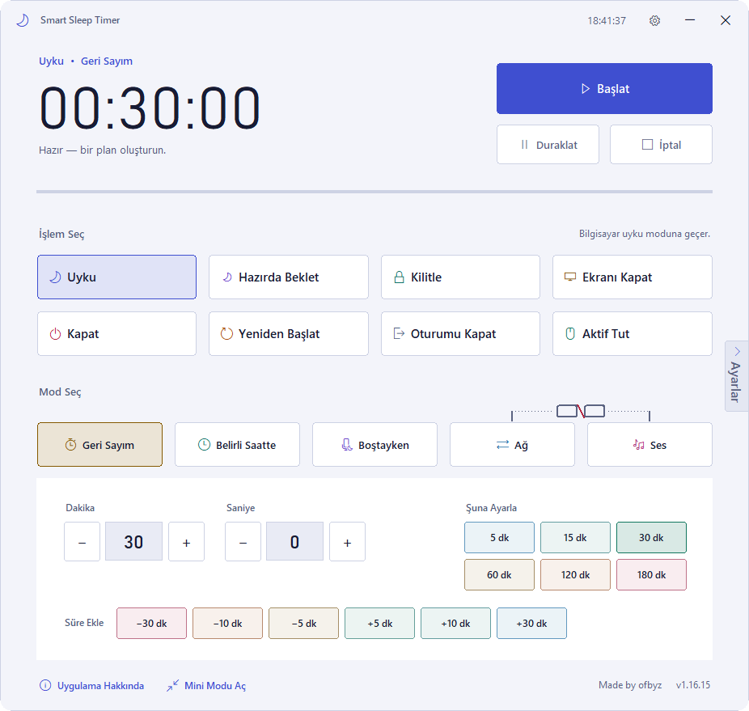

---

## Nedir?

Film izlerken uyuyakalırsınız, büyük bir indirme biter ve bilgisayarı kapatacak kimse yoktur. Sabit bir geri sayım işin ne zaman biteceğini bilemez: ya erken keser ya da geç kapatır.

Smart Sleep Timer olağan zamanlayıcı işlerini yapar; ayrıca bilgisayarın gerçekte ne yaptığına da bakabilir. Ağ ve ses hareketi sessizleşince önce “Hâlâ orada mısınız?” diye sorar, ancak ondan sonra işlemi yapar.

- **Platform:** Windows. Yazar tarafından Windows 10’da denenmiştir; diğer sürümler için bir şey doğrulayamıyorum.
- **Sürüm:** 1.16.15
- **Arayüz:** koyu ve açık tema, 10 dil (Türkçe, English, Nederlands, Deutsch, Español, Português, Rusça, Arapça, Hintçe, Basitleştirilmiş Çince).

## Nasıl çalışır: üç adım

1. **Ne olsun?** Uyku, Hazırda Beklet, Kilitle, Ekranı Kapat, Kapat, Yeniden Başlat, Oturumu Kapat. Ya da Aktif Tut.
2. **Ne zaman olsun?** Bir süre sonra, belirli bir saatte, bilgisayar boştayken ya da ağ ve ses sessizleşince.
3. **Başlat’a basın.** İşlemden önce uyarılırsınız ve istediğiniz an iptal edebilirsiniz.

## İşlemler ve modlar

| İşlemler | Modlar |
|---|---|
| Uyku · Hazırda Beklet · Kilitle · Ekranı Kapat | **Geri Sayım**: dakika ve saniye ya da hızlı düğmeler |
| Kapat · Yeniden Başlat · Oturumu Kapat | **Belirli Saatte**: 24 saatlik biçimde bir saat |
| **Aktif Tut** (süre bitince bir şey yapmaz, süre boyunca çalışan bir oturumdur) | **Boştayken**: fare ve klavye seçtiğiniz süre kullanılmazsa çalışır |
| | **Ağ**: ağ trafiği sessizlik sınırının altına inince çalışır (KB/s) |
| | **Ses**: ses seviyesi sessizlik sınırında kalınca çalışır (%) |

Ağ ve Ses zincirlenebilir. İkisi de sessiz olunca tek bir ortak süre işler.

  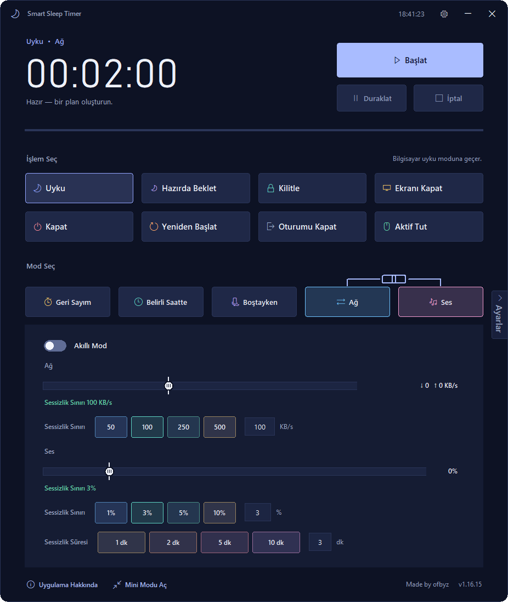

## Akıllı mod

Akıllı mod Ağ ve Ses için vardır. Sessizlik sınırını ve bekleme süresini kendisi seçer, öğrendikçe iyileşir.

**Önce sorar, sonra uyarır, sonra yapar:**

1. **Sessizlik algılanır.** Ağ veya ses öğrenilmiş sınırın altında kalır; fare ve klavye son 60 saniyedir kullanılmamıştır.
2. **“Hâlâ orada mısınız?”** Sessiz bir pencere sorar. Programın verisine güven düzeyine göre 20 ile 120 saniye açık kalır.
3. **Son uyarı.** Ayrı bir pencere geri sayar; ayarlıysa sesli uyarı da verir. En az 10 saniyedir.
4. **Cevap gelmezse işlem uygulanır.** Akıllı modda ayrıca onay istenmez; açık uygulamaları da asla zorla kapatmaz.

Her “Buradayım”, o oturum için bekleme süresine 30 saniye ekler. Her cevap, evet de olsa hayır da olsa, bir öğrenme verisidir.

### Ne kadar cesur davransın?

Akıllı ayarlar sayfasında **Temkinli / Dengeli / Cesur** seçimi vardır. Soru süresi (saniye), programın öğrendiği verilere güvenine göre değişir:

| | Çok düşük | Düşük | Orta | Yüksek | Çok yüksek |
|---|---|---|---|---|---|
| Temkinli | 120 | 100 | 80 | 60 | 45 |
| Dengeli | 90 | 75 | 60 | 45 | 30 |
| Cesur | 60 | 50 | 40 | 30 | 20 |

Seçim ayrıca iki şeyi daha değiştirir: şüpheli sensör verisinin öğrenmedeki ağırlığı (×0,5 · ×1 · ×1,6) ve işlemden önce beklenen sessizlik süresi (×1,5 · ×0,75 · ×0,6).

  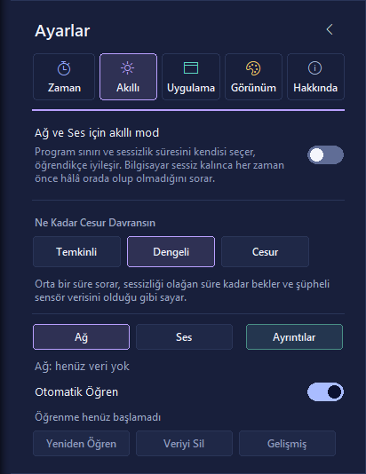
  &nbsp;
  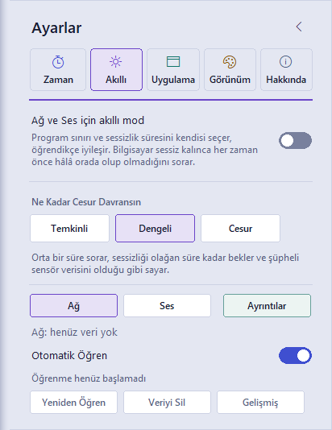

### Öğrenme

- Bilgisayarınızın “sessizliğini” saat saat öğrenir; öğrenme penceresi 7 gündür (gelişmiş ayarda 14 gün).
- Her saat için 240 sağlıklı örnek ister (15 saniyede bir), en az 3 ayrı günde.
- Alışkanlıklarınız değişirse son 3 günün verisi eskisiyle karşılaştırılır; değişen saatlerde eski örnekler 0,3 ağırlıkla sayılır.
- Öğrenme bitince en düşük işlemci yükü için dakikada bir örnekler.

### Gürültüyü kullanımdan ayırma

- **Ağ:** küçük ve tekrar eden arka plan hareketleri öğrenilir ve sayılmaz. 90 saniyeden uzun süren ya da bilinen desenlere uymayan akış kullanımdır. Karar son 30 saniyenin kırpılmış ortalamasına bakar (en yüksek %7 okuma dışarıda kalır).
- **Ses:** uygulama bazında ölçülür. 4 saniyeden kısa, tek seferlik sesler bildirim sayılır. Şu an ses veren uygulamanın örnekleri 1,5 kat ağırlıklıdır.
- **Fare ve klavye:** titreme eşiği bilgisayarınızdan öğrenilir; battaniyedeki farenin titremesi kullanım sayılmaz. Girdi yakalayan kanca (hook) yoktur, yalnızca son girdiden bu yana geçen süre okunur.

## Aktif Tut

Süre boyunca çalışan bir oturumdur: fare küçük, doğal hareketler yapar ve bilgisayar kullanımda sayılır.

- 10 saniye hazırlık, sonra 15 sn, 30 sn, 1 dk, 2 dk ya da Rastgele (5–60 sn) aralıkla hareket.
- 30 ile 420 piksel, hafif eğri; ekran kenarlarından uzak durur ve art arda aynı yöne gitmez.
- Fareyi ya da klavyeyi kullandığınız anda bekler. **Ctrl+Shift+X** ile anında durdurulur.
- Geri sayım, belirli saat ya da Boştayken olarak zamanlanabilir (bilgisayar kullanılmayınca başlar, biri dönünce biter, en çok 12 saat).

> Windows bu tür girdiyi “üretilmiş” olarak işaretler; belirli bir izleme programının bunu kabul edip etmeyeceği yalnızca denenerek anlaşılabilir. Garanti verilen bir yetenek değil, kullanıcı kontrollü bir yardımcı olarak düşünün.

  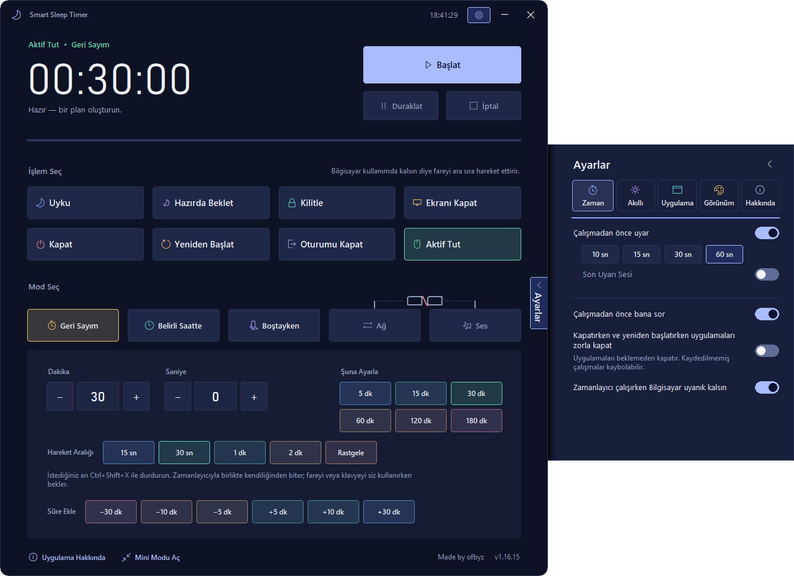

## Güvenlik

- **Son uyarı:** 10, 15, 30 ya da 60 saniye; +5 dk, +10 dk veya Zamanlayıcıyı Durdur seçenekleri vardır.
- **Son onay:** Devam / İptal sorulabilir. 10 dakika kimse yanıtlamaz ve bilgisayar neredeyse hiç kullanılmazsa işlem kendiliğinden devam eder.
- **Uykuda zamanlayıcı yaşamaz.** Sistem uykuya geçerse zamanlayıcı iptal olur ve ana pencere açılır.

  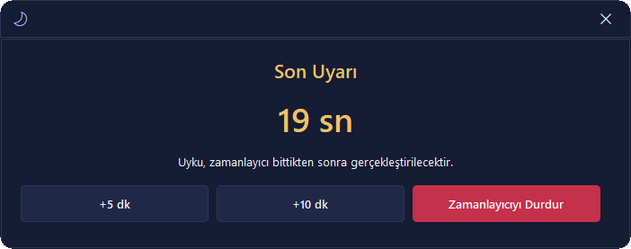
  &nbsp;
  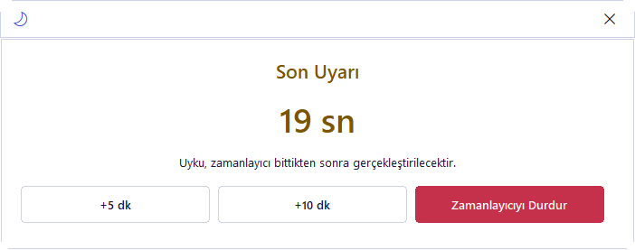

## Mini görünüm, temalar ve diller

Tepsiden tek tıkla Mini görünüm açılır. Aynı işlem ve mod seçimleri orada da vardır; Akıllı mod orada da yönetilir. Tema (Koyu, Açık ya da Sistem) ve dil Ayarlar → Görünüm sayfasındadır. Ayarlar çekmecesi sağ kenardan kayarak açılır; sayfaları Zaman, Akıllı, Uygulama, Görünüm ve Hakkında’dır.

  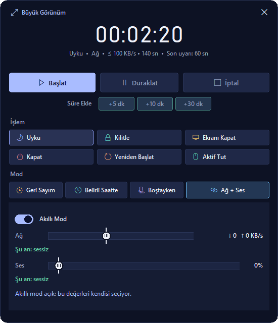
  &nbsp;
  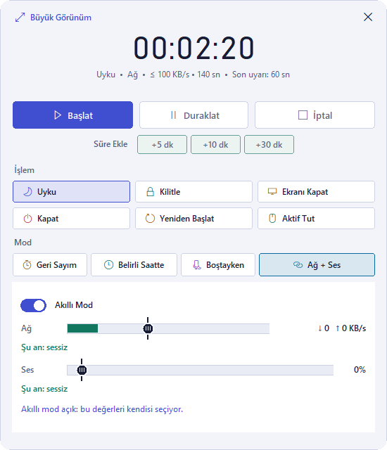
  &nbsp;
  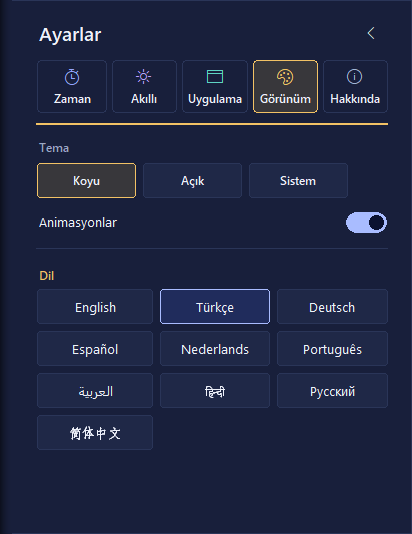

## Gizlilik

**Öğrenilen ve saklanan:** ağ etkinliği miktarı (KB/s), ses çıkış seviyesi, ses çıkaran programın adı ve bunların günün hangi saatinde olduğu.

**Hiç saklanmayan ve incelenmeyen:** web siteleri ve adresler, dosyalar ve uygulama içeriği, mesaj içerikleri ve medya başlıkları, ses kaydı, tuş vuruşları.

Veriler bilgisayarınızda, Windows’un ProgramData klasöründe tutulur (`%PROGRAMDATA%\Smart Sleep Timer`). Ağ ve Ses verileri ayrı dosyalardır. Programı kaldırırken verileri korumak ya da silmek sizin seçiminizdir.

## İndirme ve kurulum

Kurulum dosyaları bu deponun **Releases** sayfasında yayımlanır. Kurulum 10 dilde yapılabilir.

> Kurulum dosyası henüz kod imzalı değildir (v2.1.0’da planlı); çalıştırırken Windows bir uyarı gösterebilir.

## Yol haritası

Kaynak: projenin kendi `ROADMAP.md` belgesi. Tarih verilmemiştir.

- **Sıradaki:** vurgu rengi seçimi (on renk ve “Windows’u izle”); her renk iki temada kontrast testinden geçecek.
- **v2.0.0:** Özel Profiller; AND, OR, NOT, XOR, IF, FOR ile görsel algoritma editörü, hazır şablonlar, içe ve dışa aktarma. O zamana kadar kapalıdır.
- **v2.1.0:** dağıtım: kod imzalama, güncelleme yayın kanalı ve yükleyici yetki uyarısının giderilmesi.
- **Sürekli iş:** akıllı modun gerçek bilgisayarlardan toplanan karar kayıtlarıyla ince ayarı.

## Altyapı

Yaklaşık 15.800 satır Python (projenin `ARCHITECTURE.md` belgesindeki yuvarlatılmış katman değerlerinin toplamı), 631 otomatik test (son tam çalıştırma: v1.16.12) ve her renk çifti için en az 4,5:1 metin kontrastı testi. Windows çağrıları tek bir platform katmanının arkasındadır; renk, yazı tipi ve simgeler tek bir tema dosyasında toplanır.

## Projeyi destekleyin

Projeye bağış yapmak isterseniz lütfen Instagram’dan bana ulaşın: [@ofbyz](https://www.instagram.com/ofbyz)
